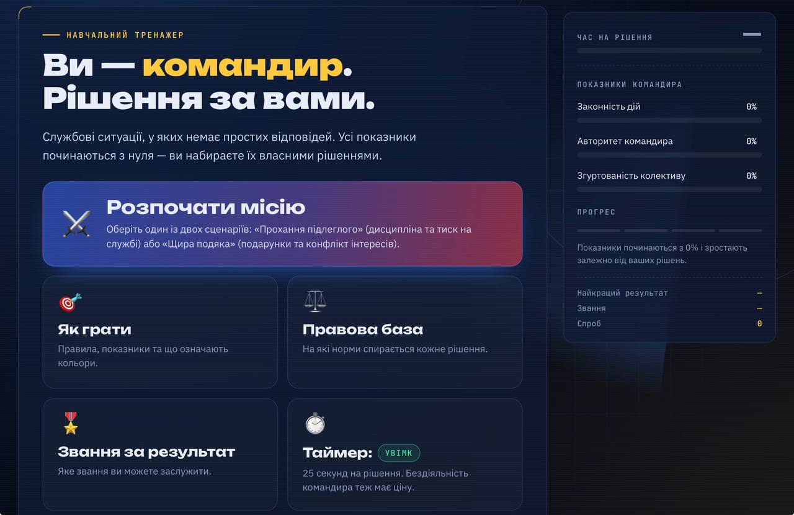
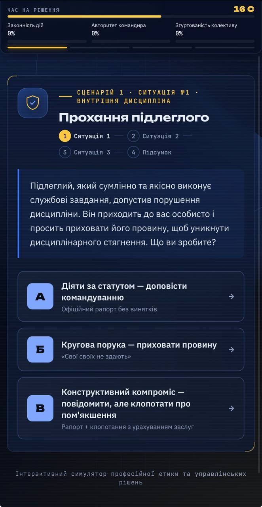
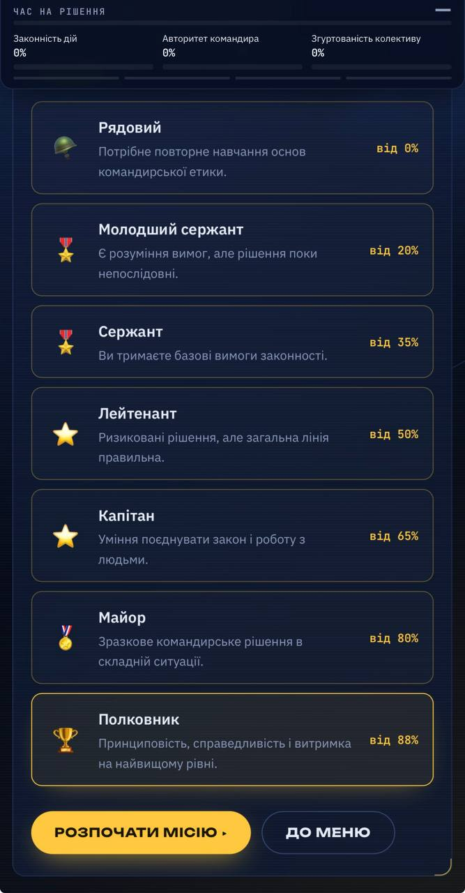
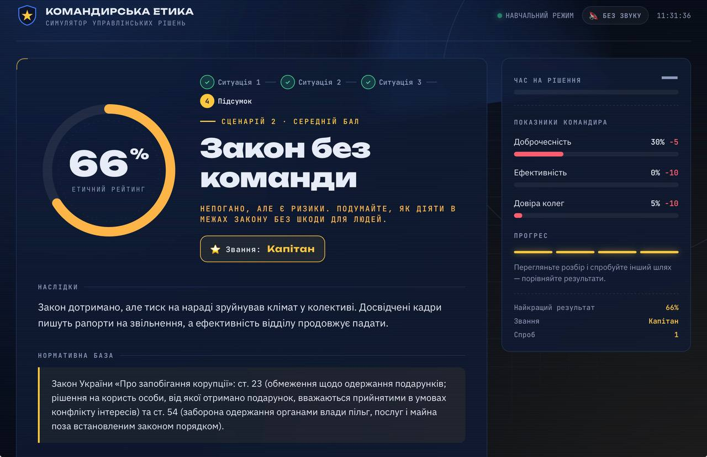

# Командирська етика - симулятор етичних дилем

Інтерактивний тренажер для курсантів та офіцерів, призначений для відпрацювання навичок прийняття управлінських рішень під час стресу, дефіциту часу та конфлікту лояльностей у службовому середовищі.

🔗 **Грати онлайн (GitHub Pages):** https://artem-pylyp.github.io/command_ethics-game/

## Про проєкт

Проєкт створено в межах **Building Integrity Hackathon 2026** за напрямом *«Симулятор етичних дилем»*. Він моделює реалістичні службові ситуації з практичної діяльності командирів та уповноважених осіб, оцінюючи наслідки вибору в умовах дотримання норм доброчесності.

## Інтерфейс

## Сценарії та механіка

* **Сценарій 1 — «Прохання підлеглого»:** внутрішня дисципліна, тиск колективу й керівництва, звітність та реагування на повторні порушення. Показники: *Законність дій*, *Авторитет командира*, *Згуртованість колективу*.
* **Сценарій 2 — «Щира подяка»:** обмеження щодо подарунків, конфлікт інтересів, пошук законних ресурсів та публічна доброчесність. Показники: *Доброчесність*, *Ефективність*, *Довіра колег*.
* **Три етапи та розгалуження:** кожен сценарій складається з трьох кроків, а розвиток подій залежить від попередніх рішень.
* **Таймер та рейтинг:** на кожне рішення відведено 25 секунд (таймер і звук можна перемикати); за підсумками формується етичний рейтинг у відсотках, присвоюється умовне звання та відкривається розбір рішень із нормативною базою.

## Нормативна база (навчальна довідка)

* Закон України «Про запобігання корупції» (зокрема ст. 22, 23, 54).
* Закон України «Про Дисциплінарний статут Національної поліції України» / статути щодо службової дисципліни.
* Правила етичної поведінки поліцейських (наказ МВС від 09.11.2016 № 1179).

## Технології та структура

* **Frontend:** HTML5, CSS3, JavaScript (однофайловий додаток `index.html`, Web Audio API, збереження прогресу в `localStorage`).
* **Дані сценаріїв:** `scenarios.json`.
* **Публікація:** GitHub Pages.

## Команда: "Пилипчинець"
